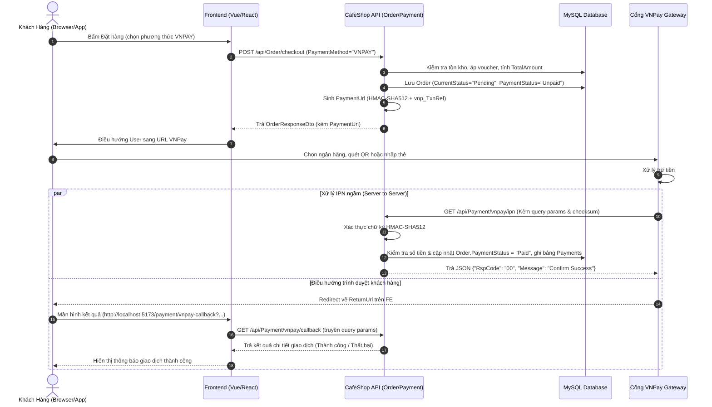

# TÀI LIỆU NGHIỆP VỤ & ĐẶC TẢ API TÍCH HỢP VNPAY — CAFE SHOP BACKEND

Tài liệu này đặc tả toàn bộ quy trình nghiệp vụ, quy tắc an toàn dữ liệu và chi tiết kỹ thuật các API tích hợp cổng thanh toán **VNPay** trong hệ thống **CafeShop**.

---

## 1. TỔNG QUAN NGHIỆP VỤ & QUY TẮC CỐT LÕI

### 1.1. Single Source of Truth (Tính toàn vẹn giá tiền)
* **Số tiền thanh toán qua VNPay** luôn lấy từ cột `TotalAmount` của thực thể `Order` trong Database:
  $$\text{TotalAmount} = \max(0, \text{SubTotal} - \text{OrderDiscount}) + \max(0, \text{ShippingFee} - \text{ShippingDiscount})$$
* Tuyệt đối không nhận hoặc tin cậy bất kỳ giá tiền nào do Client/Frontend gửi lên.
* VNPay quy định số tiền gửi sang cổng phải nhân với 100 để khử phần thập phân:
  $$\text{vnp\_Amount} = (\text{long})(\text{TotalAmount} \times 100)$$

### 1.2. Tính duy nhất của mã giao dịch (`vnp_TxnRef`)
* Cổng VNPay quy định `vnp_TxnRef` là duy nhất cho mỗi Merchant trong 1 ngày.
* Để hỗ trợ khách hàng thanh toán lại nếu lần đầu bị hủy hoặc lỗi mạng mà không bị lỗi trùng mã, hệ thống cấu trúc:
  $$\text{vnp\_TxnRef} = \text{"\{OrderId\}\_\{Timestamp\}"} \quad (\text{Ví dụ: } 105\_20261011143000)$$
* Khi VNPay gọi callback hoặc IPN gửi `vnp_TxnRef` về, Server chỉ cần tách chuỗi trước dấu `_` để lấy chính xác `OrderId`.

### 1.3. Cơ chế chống trùng lặp (Idempotency) & Database Transaction
* Tại endpoint **IPN Webhook**, hệ thống kiểm tra nếu `order.PaymentStatus == "Paid"`, trả về ngay mã `02` (`Order already confirmed`) theo chuẩn VNPay để tránh cập nhật lặp.
* Việc cập nhật `order.PaymentStatus = "Paid"` và thêm bản ghi thanh toán vào bảng `Payments` được bọc trọn vẹn trong một **Database Transaction** (`_unitOfWork.BeginTransactionAsync()`).

---

## 2. LUỒNG TUẦN TỰ (SEQUENCE DIAGRAMS)

### 2.1. Luồng Đặt Hàng & Thanh Toán VNPay (Checkout Flow)



---

## 3. ĐẶC TẢ CHI TIẾT CÁC API ENDPOINTS

### 3.1. API Đặt hàng (Checkout)
* **Endpoint:** `POST /api/Order/checkout`
* **Authentication:** Bắt buộc JWT Bearer Token (`[Authorize]`)
* **Mô tả:** Tạo đơn hàng mới từ giỏ hàng hoặc mua ngay. Nếu chọn `PaymentMethod = "VNPAY"`, hệ thống tự động sinh `paymentUrl`.

#### Request Body (`SubmitOrderRequestDto`):
```json
{
  "isBuyNow": false,
  "addressId": 12,
  "distanceKm": 3.5,
  "paymentMethod": "VNPAY",
  "voucherCode": "GIAM20K",
  "note": "Giao giờ hành chính"
}
```

#### Response Success (`200 OK`):
```json
{
  "success": true,
  "statusCode": 200,
  "message": "Đặt hàng thành công!",
  "data": {
    "orderId": 105,
    "userId": 8,
    "currentStatus": "Pending",
    "paymentMethod": "VNPAY",
    "paymentStatus": "Unpaid",
    "paymentUrl": "https://sandbox.vnpayment.vn/paymentv2/vpcpay.html?vnp_Amount=4500000&vnp_Command=pay&vnp_CreateDate=20261011143000&vnp_CurrCode=VND&vnp_IpAddr=127.0.0.1&vnp_Locale=vn&vnp_OrderInfo=Thanh+toan+don+hang+105&vnp_OrderType=other&vnp_ReturnUrl=http%3A%2F%2Flocalhost%3A5173%2Fpayment%2Fvnpay-callback&vnp_TmnCode=7TVALFFI&vnp_TxnRef=105_20261011143000&vnp_Version=2.1.0&vnp_SecureHash=a9b3...",
    "subTotal": 50000,
    "orderDiscount": 20000,
    "shippingDiscount": 0,
    "shippingFee": 15000,
    "totalAmount": 45000,
    "items": [ ... ]
  }
}
```

---

### 3.2. API Tạo lại URL thanh toán VNPay
* **Endpoint:** `POST /api/Payment/vnpay/create-url`
* **Authentication:** Bắt buộc JWT Bearer Token (`[Authorize]`)
* **Mô tả:** Sử dụng khi khách hàng mở "Lịch sử đơn hàng", tìm thấy đơn có `PaymentStatus == "Unpaid"` và bấm **"Thanh toán ngay bằng VNPay"**.

#### Request Body (`CreatePaymentUrlRequestDto`):
```json
{
  "orderId": 105
}
```

#### Response Success (`200 OK`):
```json
{
  "success": true,
  "statusCode": 200,
  "message": "Tạo liên kết thanh toán VNPay thành công!",
  "data": {
    "orderId": 105,
    "amount": 45000,
    "paymentUrl": "https://sandbox.vnpayment.vn/paymentv2/vpcpay.html?vnp_Amount=4500000&..."
  }
}
```

#### Các lỗi nghiệp vụ:
| HTTP Status | Điều kiện phát sinh | Thông báo trả về |
| :--- | :--- | :--- |
| `400 Bad Request` | Đơn hàng không tồn tại | `Không tìm thấy đơn hàng cần thanh toán!` |
| `403 Forbidden` | `order.UserId` khác với `userId` trong Token | `Bạn không có quyền thanh toán cho đơn hàng này!` |
| `400 Bad Request` | Đơn hàng đã thanh toán trước đó | `Đơn hàng này đã được thanh toán trước đó!` |
| `400 Bad Request` | Đơn hàng đã bị hủy | `Đơn hàng đã bị hủy, không thể tiếp tục thanh toán!` |

---

### 3.3. API Callback kết quả thanh toán (Return URL)
* **Endpoint:** `GET /api/Payment/vnpay/callback`
* **Authentication:** Public (`[AllowAnonymous]`)
* **Mô tả:** Sau khi thanh toán trên VNPay, VNPay redirect trình duyệt của khách hàng về Frontend URL (ví dụ: `http://localhost:5173/payment/vnpay-callback?vnp_Amount=...&vnp_ResponseCode=00...`). Frontend chuyển tiếp toàn bộ Query String này tới Backend để xác thực chữ ký và lấy thông điệp kết quả.

#### Query Parameters:
Toàn bộ các tham số bắt đầu bằng `vnp_*` do VNPay redirect về:
* `vnp_TxnRef`: Mã giao dịch gửi đi (ví dụ: `105_20261011143000`)
* `vnp_Amount`: Số tiền (`4500000`)
* `vnp_ResponseCode`: Mã kết quả giao dịch (`00`: Thành công, `24`: Hủy giao dịch,...)
* `vnp_TransactionNo`: Mã giao dịch ghi nhận tại cổng VNPay
* `vnp_BankCode`: Mã ngân hàng thanh toán (NCB, VCB,...)
* `vnp_SecureHash`: Chữ ký băm HMAC-SHA512

#### Response Success (`200 OK`):
```json
{
  "success": true,
  "statusCode": 200,
  "message": "Giao dịch thành công!",
  "data": {
    "success": true,
    "orderId": 105,
    "transactionNo": "14589231",
    "bankCode": "NCB",
    "amount": 45000,
    "responseCode": "00",
    "message": "Giao dịch thành công!"
  }
}
```

#### Response Thất bại (`400 Bad Request`):
```json
{
  "success": false,
  "statusCode": 400,
  "message": "Khách hàng hủy giao dịch.",
  "data": {
    "success": false,
    "orderId": 105,
    "transactionNo": "0",
    "bankCode": "NCB",
    "amount": 45000,
    "responseCode": "24",
    "message": "Khách hàng hủy giao dịch."
  }
}
```

---

### 3.4. API Webhook IPN (Instant Payment Notification)
* **Endpoint:** `GET /api/Payment/vnpay/ipn`
* **Authentication:** Public Webhook (`[AllowAnonymous]`)
* **Mô tả:** Server VNPay chủ động gọi ngầm trực tiếp (Server-to-Server) tới Backend. Đây là nguồn chuẩn xác nhất để cập nhật trạng thái đơn hàng.
* **Định dạng trả về:** Phải tuân thủ 100% chuẩn định dạng VNPay yêu cầu, **không bọc** trong `ApiResponse<T>`.

#### Bảng mã phản hồi IPN theo đặc tả kỹ thuật VNPay:
| RspCode | Message | Ý nghĩa / Khi nào trả về |
| :--- | :--- | :--- |
| **`00`** | `Confirm Success` | Giao dịch hợp lệ, cập nhật database thành công |
| **`01`** | `Order not found` | Không tìm thấy Order tương ứng với `vnp_TxnRef` |
| **`02`** | `Order already confirmed` | Đơn hàng đã ở trạng thái `Paid` trước đó |
| **`04`** | `Invalid amount` | Số tiền VNPay báo không khớp với `order.TotalAmount` |
| **`97`** | `Invalid Checksum` | Sai chữ ký băm bí mật `vnp_SecureHash` |
| **`99`** | `Unknown error` | Ngoại lệ hệ thống / Lỗi Database Transaction |

#### Response mẫu:
```json
{
  "RspCode": "00",
  "Message": "Confirm Success"
}
```

---

## 4. BẢNG TRA CỨU MÃ LỖI VNPAY (`vnp_ResponseCode`)

| Mã lỗi | Ý nghĩa |
| :--- | :--- |
| **00** | Giao dịch thành công |
| **07** | Trừ tiền thành công. Giao dịch bị nghi ngờ (liên quan tới lừa đảo, bất thường). |
| **09** | Thẻ/Tài khoản chưa đăng ký dịch vụ InternetBanking tại ngân hàng. |
| **10** | Khách hàng xác thực thông tin thẻ/tài khoản không đúng quá 3 lần. |
| **11** | Đã hết hạn chờ thanh toán. Quý khách vui lòng thực hiện lại. |
| **12** | Thẻ/Tài khoản của khách hàng đang bị khóa. |
| **13** | Quý khách nhập sai mật khẩu xác thực giao dịch (OTP). |
| **24** | Khách hàng hủy giao dịch. |
| **51** | Tài khoản của quý khách không đủ số dư để thực hiện giao dịch. |
| **65** | Tài khoản của quý khách đã vượt quá hạn mức giao dịch trong ngày. |
| **75** | Ngân hàng thanh toán đang bảo trì. |
| **79** | Khách hàng nhập sai mật khẩu thanh toán quá số lần quy định. |
